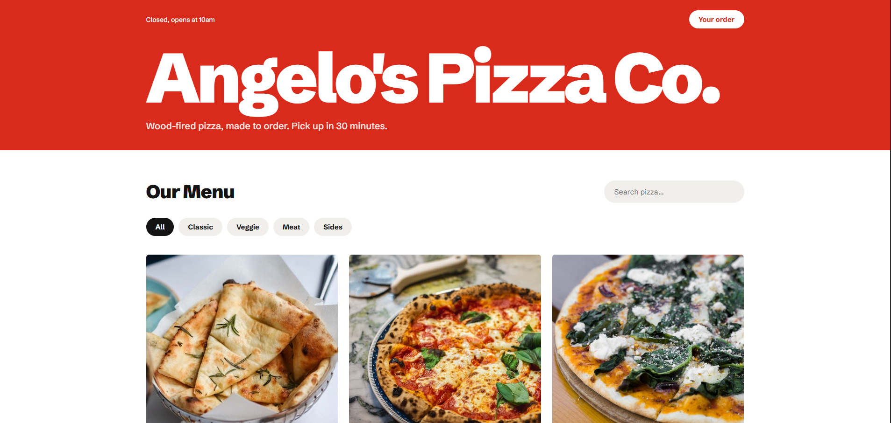

# Angelo's Pizza Co.

A pizza ordering app built with React. Started as a first-week React exercise, then I redesigned it and added a full ordering flow.

**Live site:** _add your Vercel link here_



## Features

- **Live search** and **category tabs** (Classic, Veggie, Meat, Sides) to filter the menu
- **Add to order** from each pizza. The button turns into a quantity stepper once it's in the order
- **Order panel** with quantities and a running total
- **Checkout form** with validation (name, Singapore phone number, pickup time) and an order confirmation
- **Order is saved** in `localStorage`, so it stays after a refresh
- **Open or closed status** based on the real time, and checkout is blocked when the shop is closed
- **Responsive** layout (3, 2 or 1 columns), keyboard focus styles, `Esc` closes the order panel, and reduced motion is respected

## Built with

- React (useState, useEffect)
- CSS (grid, flexbox, custom properties)

## Run it locally

```
npm install
npm start
```

Then open http://localhost:3000

## What I'd add next

- Save orders to a real backend instead of the browser
- Pizza sizes and extra toppings